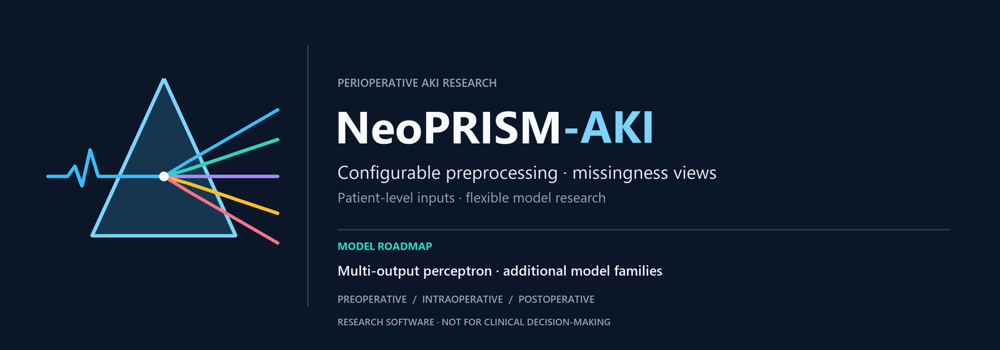
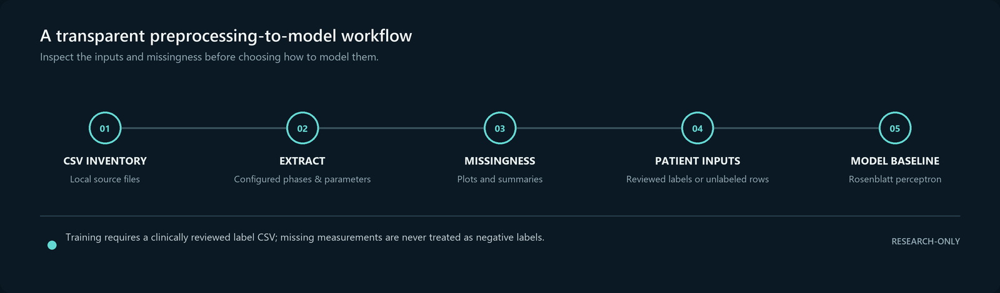

# NeoPRISM-AKI

[](https://github.com/b64Lorenzo/NeoPRISM-AKI/releases/latest)



NeoPRISM-AKI (Neonatal and Early-Childhood Perioperative Risk Inference and Sequential Modelling) is a research-only Python framework for retrospective perioperative data. It provides configurable parameter extraction, phase-aware missingness views, patient-level model inputs, a **binary Rosenblatt perceptron**, **multinomial logistic regression**, a **multilayer perceptron (MLP)**, and a **hard multiclass multi-output perceptron**. The three multiclass training workflows execute in real local Ray workers; the MLP supports configurable widths and different activations per hidden layer. An optional XML pipeline runs configured stages and models without replacing the existing INI catalogs or standalone commands.

**The project does not infer clinical AKI outcomes from missing measurements.** A clinically adjudicated label CSV is required for training. Unknown labels remain unknown and are excluded from training, never converted to No AKI. The Rosenblatt and hard multi-output models produce **hard class labels and uncalibrated linear scores**, not AKI risk probabilities. Logistic regression and the MLP produce class probabilities that still require out-of-sample calibration and clinical validation. It is not a clinical decision-support system.



## Quick start

From the project root with Python 3.12 or 3.13 and [uv](https://docs.astral.sh/uv/):

```bash
uv sync --group dev
uv run python -m src.cli --help
uv run python -m pytest -q tests src/models/rosenblatt_perceptron/tests src/tests
```

1. Keep your existing `config/parameters.ini` and `config/plotting.ini`; merge the supplied `*.additions.ini` snippets without duplicate section headers.
2. Run parameter extraction to populate `results/parameters/{preoperative,intraoperative,postoperative}/ref_*.csv`.
3. Copy `config/inputsModel.example.ini` to `config/inputsModel.ini`, and edit the exact `phase/parameter_id` features to match your parameter catalog.
4. Create a clinically reviewed label CSV with `patient_id,aki_label` as documented in [model inputs and labels](docs/model-inputs-and-labels.md). Missing outcomes remain unknown, never negative.
5. Run `python -m src.cli inputs-model --config config/inputsModel.ini`.
6. Run `python -m src.cli rosenblatt-train --input results/inputsModel/patients_labeled.csv --output results/models/rosenblatt_perceptron`.
7. For new patients, run `python -m src.cli inputs-model --config config/inputsModel.ini --unlabeled` on the new extraction directory, then `python -m src.cli rosenblatt-predict --model results/models/rosenblatt_perceptron/model.json --input results/inputsModel/patients_unlabeled.csv --output results/models/rosenblatt_perceptron/novel_predictions.csv`.

See [model-input documentation](docs/model-inputs-and-labels.md), [model documentation](docs/rosenblatt-perceptron.md), [plotting documentation](docs/plotting-and-patient-dashboards.md), [release process](docs/release-process.md), and [project structure](docs/code-structure.md).

Rosenblatt training matches the [NNCI course implementation](docs/rosenblatt-perceptron.md):
fixed example order, update `y*x/N`, homogeneous by default, and strictly
positive-margin convergence. Add `--clamped` for a bias input and denominator
N+1. The split seed is separate from training; custom Rosenblatt learning rates
are no longer supported. Existing saved models remain usable for inference.

## Additional models and XML pipeline

```bash
uv run python -m src.cli logistic-train --config config/models.example.ini --input results/inputsModel/patients_labeled.csv --output results/models/logistic_regression
uv run python -m src.cli mlp-train --config config/models.example.ini --input results/inputsModel/patients_labeled.csv --output results/models/multilayer_perceptron
uv run python -m src.cli multioutput-train --config config/models.example.ini --input results/inputsModel/patients_labeled.csv --output results/models/multi_output_perceptron
uv run python -m src.cli pipeline --config config/pipeline.xml
```

Edit [the commented model INI](config/models.example.ini) for widths, per-layer activations, initialization, learning and Ray settings; see [configuration and precedence](docs/model-configuration.md). With `--config`, do not also supply architecture/training flags. Without INI, legacy flags remain supported and still use Ray. Saved-model prediction does not start or import Ray. Ray support on Windows is beta.

The checked-in XML files have every stage disabled: edit explicit paths, feature columns and `run` flags before use. XML coordinates existing INI-configured preprocessing and independent model entries. See [classification models and reusable confusion matrices](docs/classification-models.md) and [XML configuration/extension guide](docs/xml-pipeline.md). Use `--target-column aki_stage` on any multiclass training command for four-stage classification; the default remains binary `aki_label`.

## Research safeguards

- All features are explicitly selected by phase; postoperative observations must not be used as predictors for postoperative AKI.
- For preoperative prediction select only preoperative features. End-of-surgery predictors may include intraoperative summaries available by surgery end. `operation_duration` is **not** available before operation end.
- For sequential snapshots, specify `cutoff_minutes` and use only observations genuinely available by the cutoff; extraction timestamps alone may not capture laboratory reporting delay.
- Patients are split before feature preprocessing. Numeric imputation/standardisation and categorical vocabularies are learned from training patients only.
- The split is patient-disjoint and stratified when each class has at least two patients. External validation, confidence intervals, calibration, temporal drift and outcome adjudication are still needed.
- CSVs and `split.json` contain patient identifiers: store them in approved locations, not a public Git repository. Model JSON contains weights and preprocessing statistics, but no patient identifiers.

## Tests

```bash
python -m pytest -q tests src/models/rosenblatt_perceptron/tests src/tests
```
