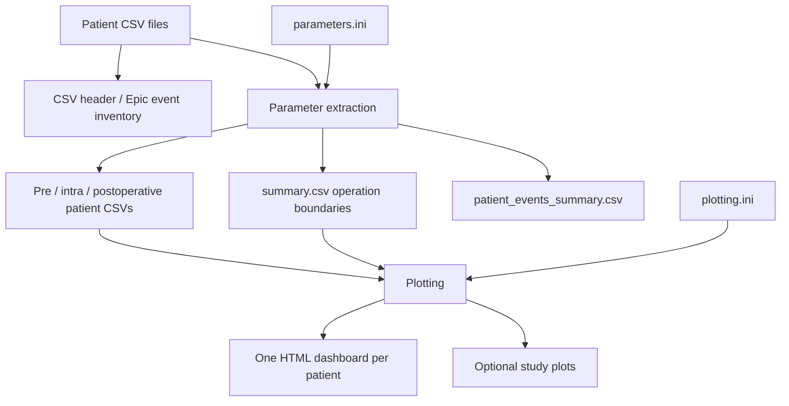

# Code structure

The `src/` package separates input inventory, clinical extraction, visualization and models. Existing commands retain their INI configuration. The optional `src/pipeline/` XML layer orchestrates those components without duplicating their algorithms or migrating their catalogs.

```text
src/
  cli.py                           # Registers subcommands and error handling
  preprocessing/
    csv_header/
      inventory.py                 # Header inventory of patient CSVs
      events.py                    # Event value inventory and global/per-patient summaries
      run.py                       # csv-header command
    parameters/
      config.py                    # Parameter, boundary and derivation INI parser
      derivation.py                # Deterministic patient-local BMI derivation
      extractor.py                 # Boundary detection, phase assignments and CSV export
      run.py                       # parameters-extraction command
    plotting/
      config.py                    # Plotting INI parser
      selection.py                 # Catalog and phase/parameter filters
      data.py                      # Extracted observations, Epic events and boundary metadata
      plots.py                     # Optional multi-patient research charts
      patient_dashboard.py         # One standalone HTML dashboard per patient
      run.py                       # plotting command
  utils/
    csv_utils.py                   # PatientCsvReader and CSV helpers
    patient_files.py               # Find and group patient CSV parts
    logger.py                      # Console logging
```

## Data flow



### Configuration ownership

- `parameters.ini` controls **what to extract**, when phases start/end, source fields, types and deterministic derivations.
- `models.ini` controls classifier architecture, per-layer activations, optimizer settings and local Ray resources; data paths, features, targets and split stay in CLI/XML.
- `plotting.ini` controls **what to display**, which patients and phases to load, output directories and chart themes.
- `patient_dashboard.py` renders one patient's observations, but never recalculates patient boundaries: `data.py` reads them from the extraction summary.

### Command contracts

`parameters-extraction` takes raw patient CSV files and produces clinical observations and metadata. `plotting` consumes the extracted directory, **not** the raw Epic CSV. To change boundary phrases, rerun extraction before plotting. The current source declares CLI entrypoints under `src.cli`; `pipeline --config config/pipeline.xml` optionally coordinates the same stage functions. Paths in XML are relative to its directory; paths inside referenced INIs retain their existing semantics.

### Test conventions

Use `uv run python -m pytest -q` or `uv run python -m unittest discover -s src/tests` as appropriate for your test layout. Tests should create temporary files, avoid real patient records and verify the presence *and absence* of boundaries explicitly.

## Current extension points

The INI-based pipeline's `src/preprocessing/parameters/derivation.py` owns a registry of deterministic calculations. The extraction engine does not need a new branch for every formula: add `@register("name")` and return `DerivedValue` (or `None` for unavailable inputs). `DerivationContext` exposes patient-local extracted observations and configured boundary timestamps. See [Derived parameters](derived-parameters.md) for BMI, operation duration, and validation requirements.

Plotting's `config.py` reads `[value_heatmaps] parameter_ids`, while `run.py` independently resolves those parameters against the full extraction catalog. `plots.py` renders only the selected numeric heatmap columns. Other plots and patient dashboards continue to use the general `[selection]` filter. See [Plotting](plotting-and-patient-dashboards.md).


## Added model packages

`src/preprocessing/inputsModel/` builds one-row-per-patient matrices and reads independently adjudicated AKI labels. `src/models/rosenblatt_perceptron/` holds the binary course-aligned baseline, retains the train/predict entry points, and reads existing saved artifacts for inference. New training semantics and the removed rate override are described in the [migration guide](rosenblatt-perceptron.md#migration-from-the-earlier-adaptation).

```text
src/models/
  contracts.py                   # Shared feature/target/activation contracts
  data.py                        # Patient matrices, stratified splits and frozen transforms
  classification.py              # Driver-owned split/transform/reports and Ray orchestration
  config.py                      # Immutable, strict model INI profiles; stdlib only
  factory.py                     # Numerical model construction and portable restoration
  ray_backend.py                 # Actual local worker tasks, resources and lifecycle
  evaluation/                    # Binary/multiclass confusion matrices and reports
  neural_network/                 # activation_func.py, nnUtils.py, nnClass.py (MLP)
  logistic_regression/            # Regularized multinomial softmax model
  multi_output_perceptron/        # Sequential multiclass mistake learner; raw scores
  rosenblatt_perceptron/          # Existing binary baseline
  run.py                         # Logistic/MLP/multioutput CLI registration
src/pipeline/
  config.py                      # Strict XML parsing, typed stage/model configuration
  registry.py                    # Extensible option-parser/runner pairs
  run.py                         # Ordered execution and pipeline CLI registration
```

The numerical kernels remain independent of Ray, splitting and I/O. The shared
patient workflow sends numeric arrays/settings to one Ray task per fit, not raw
clinical records or patient IDs. Inference restores JSON without Ray.

See [model configuration](model-configuration.md), [classification models](classification-models.md), [XML pipeline](xml-pipeline.md), and [Rosenblatt perceptron](rosenblatt-perceptron.md).
