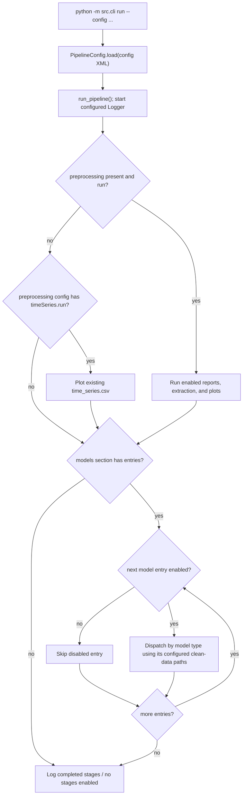
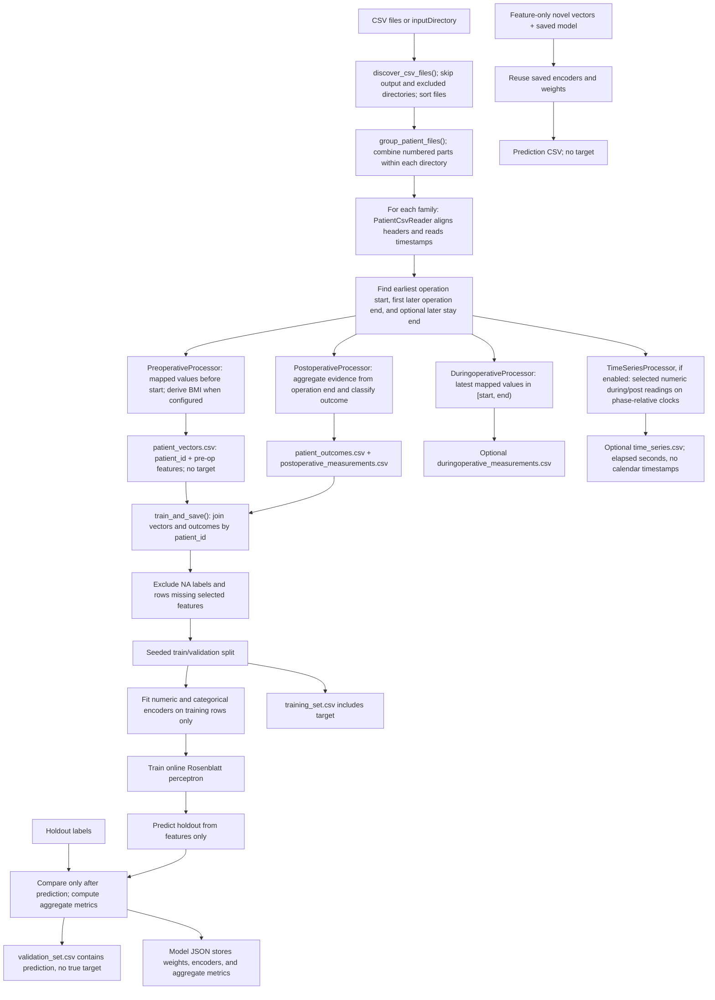

# Code structure

Packages follow structured XML components. A component owns its parser and implementation; scalar options stay on their parent rather than becoming tiny packages.

```text
src/
  cli.py                         # Single XML pipeline run entrypoint
  pipeline/                      # Root configuration and stage orchestration
  logging/                       # LoggingConfig and per-run Logger
  preprocessing/
    config.py                    # Composes the preprocessing children
    parameters/
      config.py                  # Definitions and selection have one owner
      parameter_map.py           # Typed catalog parsing, validation and standalone IO
      settings.py                # Shared settings and reusable filtering
      phase.py                   # Phase-owned end events and filters
    parameter_descriptions/      # Reference configuration and Markdown writer
    csv_header_descriptions/     # Header-only inventory configuration and implementation
    preoperative/                # Pre-operative feature extraction
    duringoperative/             # During-operative measurements
    postoperative/               # Post-operative measurements and outcome rules
    time_series/                 # Phase-relative reading export
    plotting/
      config.py                  # Common plot options and typed child settings
      heatmaps.py
      selection.py               # Shared phase/parameter/class selection
      distributions/             # Own settings and patient-level distribution plots
      missingness_by_patient/    # Own selection, destination and missingness renderer
      time_series/               # Plot filters and time-series plotting
      patient_timeline/          # Dashboard settings, generation and HTML view
        layout/                  # Typed chart/panel dimensions
    patient_pipeline.py          # Patient-level extraction coordination
    row_pipeline.py              # Distinct historical row-oriented analysis
  models/
    base.py                      # Model configuration interface
    config.py                    # Optional model instances and per-instance IDs
    registry.py                  # XML model type → configuration class
    runner.py                    # Configuration class → execution handler
    training_validation/         # Supervised settings and model-owned feature schema
    novel_data/                  # Saved-model prediction input/output settings
    plotting/                    # Reusable model-plot settings
    perceptron/                  # Algorithm, own configuration and shared train/save workflow
  plotlib/                       # Shared Plotly HTML output only
  utils/                         # XML values/projection, CSV reading and aggregate table IO
```

`plotting/selection.py` applies visual-only phase, parameter-ID, and class filters. Distribution and missingness plots own independent XML settings; these filters do not change extraction, outcomes, or model inputs.

## Runtime flow

`python -m src.cli` exposes one subcommand: `run`. Its `--config` option selects the XML pipeline configuration; the default is `config/pipeline.xml`. Preprocessing, plotting, and model behavior are selected through that configuration, not separate CLI commands.



### Patient data and model flow



The post-operative stay-end event supports duration summaries; it does not truncate the broader postoperative evidence window. Patient-scope measurements are the explicit exception to timestamp-scoped postoperative extraction. Pre-operative vectors and postoperative labels stay separate throughout training and prediction.

## Configuration entrypoints

```python
from src.pipeline.config import PipelineConfig, load_pipeline_config

config = PipelineConfig.load("config/pipeline.xml")  # Typed tree; no patient data opened
if config.preprocessing is not None:
    selected = config.preprocessing.parameters.selected_map()
model_instances = config.models.models
runtime = load_pipeline_config("config/pipeline.xml")  # Runtime dictionary
```

The single `<preprocessing><parameters formatVersion="1">` contains **settings, preOperative, duringOperative, postOperative**, in that order. Selection is optional execution behavior, controlled by `settings/selectionEnabled` and the filters on each phase; there is no selection subpackage. Catalog loading returns all definitions and does not silently apply filters. `selected_map()` applies enabled filters without mutating the catalog. A standalone `<parameterMap>` keeps its existing typed-object representation.

Shared XML readers live in `src/utils/utils.py`; common dataclass projection and run/output settings live in `src/utils/config.py`. CSV discovery and patient-family grouping live in the shared `src/utils/patient_files.py`; XML uses a scalar `preprocessing/inputDirectory`. Preprocessing and plotting do not import the root pipeline parser. `__init__.py` files stay lightweight, avoiding eager-import cycles.

## Models

Add a model under `src/models/<name>/`, subclass `ModelConfig`, and register its configuration class in `MODEL_CONFIGS`. Register its execution handler in `MODEL_RUNNERS`; a parser alone does not make a model runnable. The pipeline parses zero or more `<models><model id="..." type="...">` entries and invokes each enabled entry in order. Each model owns its clean-data paths; the generic runner does not inject preprocessing outputs or a global parameter map. The perceptron declares its vector feature IDs and numeric/categorical types in its own training configuration. Its `train_and_save` workflow preserves patient-keyed joining and prediction-only holdout exports. Outcome rules belong to preprocessing, not to the classifier.

Update `config/pipeline.xsd`, both XML examples, documentation, and synthetic tests when adding a structured node. Keep the XSD's named types and element documentation complete. Old flat `src.*` module imports are replaced by the component paths above; there are no duplicate compatibility modules.

## Verification

From the repository root, use the project interpreter:

```powershell
.venv\Scripts\python.exe -m unittest discover -s tests -v
.venv\Scripts\python.exe -m src.cli --help
.venv\Scripts\python.exe -m ruff check src tests
```

Ruff and lxml are optional development tools, not runtime dependencies. Install them with the same interpreter (`python -m pip install ruff lxml`) when needed. The standard-library test suite remains runnable without them; lxml-specific schema tests skip when lxml is absent. The runtime still needs `requirements.txt` for Plotly.

Validate XML independently of runtime semantic checks with:

```text
xmllint --noout --schema config/pipeline.xsd config/pipeline.xml config/pipeline.template.xml
```

Never use the active cohort configuration as a test default: copy a configuration into an isolated temporary project and rebase every input, output and log path onto synthetic fixtures. Do not open patient inputs merely to verify a package refactor.
