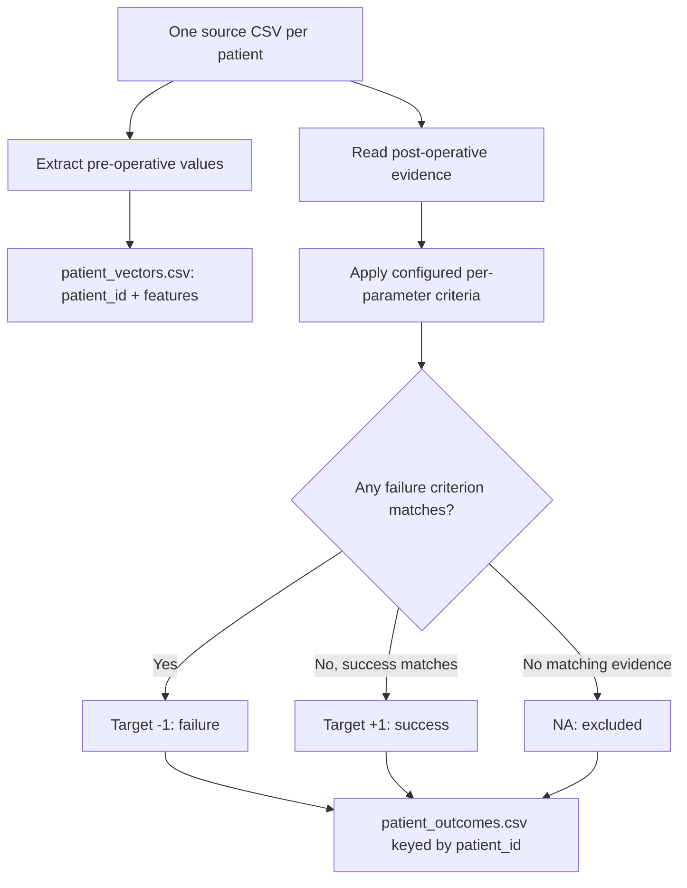
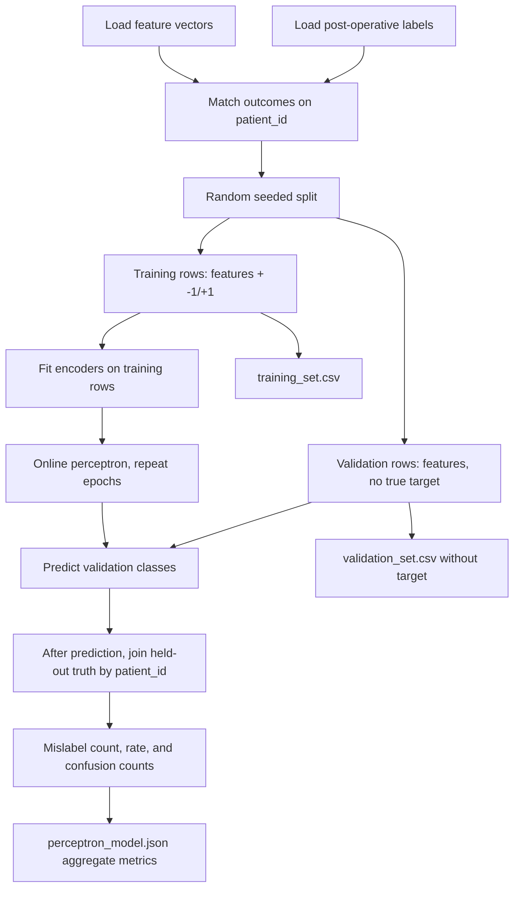

# Perceptron training and validation

Analysis produces two modeling files, joined by `patient_id`:

- `results/patient_vectors.csv`: pre-operative features only; no outcome label.
- `results/patient_outcomes.csv`: target and label evidence computed from post-operative observations.

A third CSV, `postoperative_measurements.csv`, keeps the aggregated post-operative values available for audit and plots. It is never a model input. This replaces the previous collection of duplicate CSV reports with three core extracts.



## Split, train, and evaluate

Configure a model instance under `models/model` in `config/pipeline.xml`, set its `type="perceptron"`, `id`, and `run`, then choose `mode` (`train-validation` or `novel-data`). To extract vectors/outcomes first, set the top-level `preprocessing/run` to `true`, then configure the model's vector and outcome paths to those generated files. Set `preprocessing/plotting/run` separately if you also want heatmaps or distributions. Those model paths are explicit; the runner does not substitute preprocessing outputs automatically. To use already-clean data, omit `<preprocessing>` or set its top-level `run` to `false` and set the perceptron paths to your clean files. In either case, list the vector columns and their types under `trainingValidation/features` (`numeric` or `categorical`). Then run:

```powershell
py -3 -m src.cli run --config config/pipeline.xml
```

The CLI has no standalone `analyze` or `train-perceptron` command. Each `<model>` entry owns its input and output paths, and multiple entries can run in one pipeline if their IDs and output paths are distinct. Omitting `<models>` runs no model. See the [XML pipeline guide](xml-pipeline-configuration.md#models) for the XML structure and version 1 migration.

Training verifies that vector and outcome files have the same unique patient IDs, then joins by ID—not row order. The training set receives the post-operative target (`-1` failure, `+1` success). The validation set has no **true target**; the perceptron classifies its pre-operative features and writes a `prediction` column. Only after that prediction does evaluation look up postoperative truth for the same `patient_id` and calculate validation statistics. Rows with an `NA` outcome or missing selected input are excluded and counted.



The model uses the sequential Rosenblatt update. Weights begin at zero; for label `y` and encoded feature vector `x`, update when `y(w·x) ≤ 0` using `wᵢ ← wᵢ + yxᵢ/N`. Numeric scaling and categorical one-hot levels are fitted only on training rows. Training stops after a no-update epoch or the epoch limit.

## Output and statistics

In `train-validation` mode, the model stage writes `training_set.csv` (features plus the true `target`), `validation_set.csv` (features plus `prediction`; no true `target`), and `perceptron_model.json`. The JSON includes aggregate validation metrics, not patient rows or IDs:

- `misclassified`: validation cases where prediction differs from post-operative truth.
- `mislabeling_rate`: `misclassified / validation_size` (also the generalization error).
- `confusion`: counts for actual failure/success versus predicted failure/success.
- Training settings, encoding, weights, convergence, and excluded-row count.

When enabled in XML, the aggregate confusion matrix is also saved as interactive Plotly HTML (`results/perceptron_confusion_matrix.html` by default); the plot contains counts only, not patient rows or IDs.

Feature IDs/types, omitted feature IDs, and output paths are configured in that model's XML `trainingValidation` settings; the default `config/pipeline.xml` omits `operation_diagnosis_proxy`. There are no standalone CLI flags for training options. At least three eligible rows are required; the split must leave two training rows and one validation row, and training must contain both classes. Missing BMI is derived only during preprocessing; for already-clean model data, include the prepared BMI column and declare it numeric in the model feature list. Rows still missing another selected feature are excluded.

A single random holdout is a noisy estimate, especially for a small dataset. The perceptron is a hard linear classifier, not a calibrated probability estimator. Outcome criteria are project rules, not clinically validated endpoints; eight postoperative parameter thresholds remain pending clinical definition.
